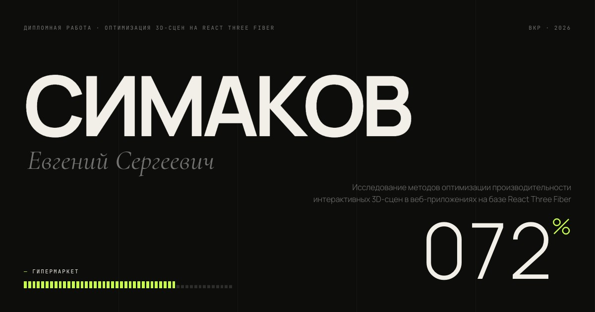

# Exploded Niva Concept

An interactive, scroll-driven exploded view of the LADA Niva Concept, built with Three.js, React Three Fiber and WebGL.

**Live demo:** [simakov.space/new](https://simakov.space/new)



## Interaction

- Scroll to move through the camera story and open the vehicle.
- Drag or touch the scene to orbit the camera.
- Select body parts to customise colour, gloss and metallic finish.
- Use X-ray mode to inspect the internal composition.

## Highlights

- Scroll-synchronised camera path and exploded-view animation.
- Runtime material customisation with direct mesh picking.
- X-ray transition with a wireframe overlay.
- HDR image-based lighting and procedural scene effects.
- Adaptive device pixel ratio for a responsive WebGL experience.
- Asset preloading and shader warm-up to minimise first-interaction stutter.

## Stack

- [Three.js](https://threejs.org/)
- [React](https://react.dev/)
- [React Three Fiber](https://docs.pmnd.rs/react-three-fiber/)
- [React Three Drei](https://github.com/pmndrs/drei)
- [Vite](https://vite.dev/)

## Local development

```bash
npm install
npm run dev
```

Create a production bundle with:

```bash
npm run lint
npm run build
```

## Asset attribution

Credits and licence notes for bundled third-party assets are in [ASSETS.md](./ASSETS.md).

## Author

Created by [Evgenii Simakov](https://simakov.space/).
